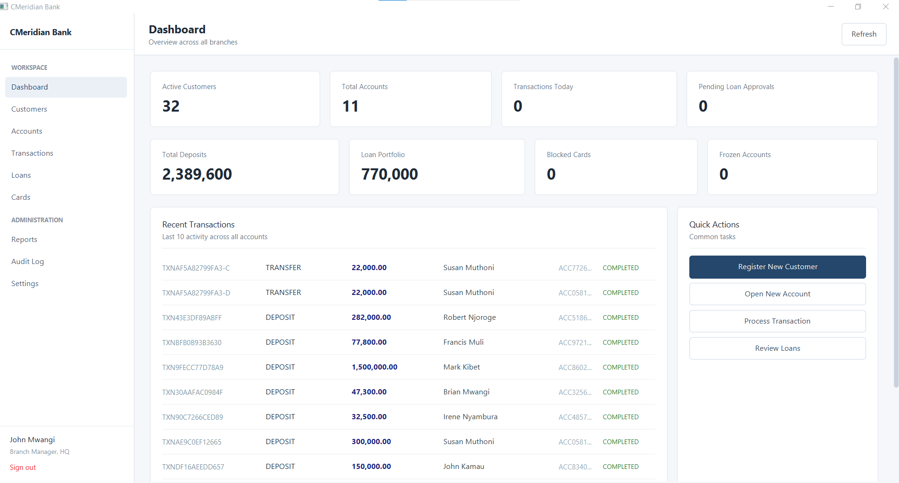
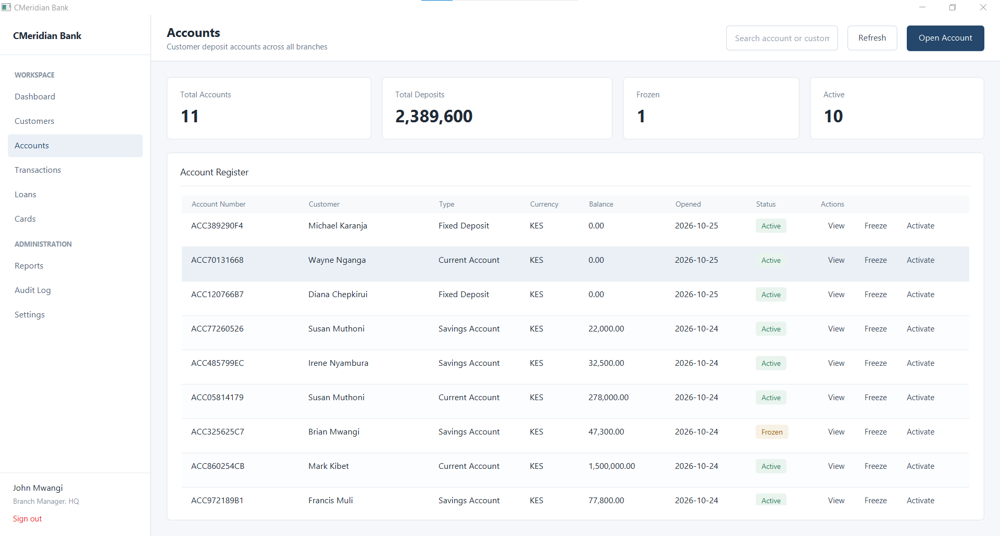
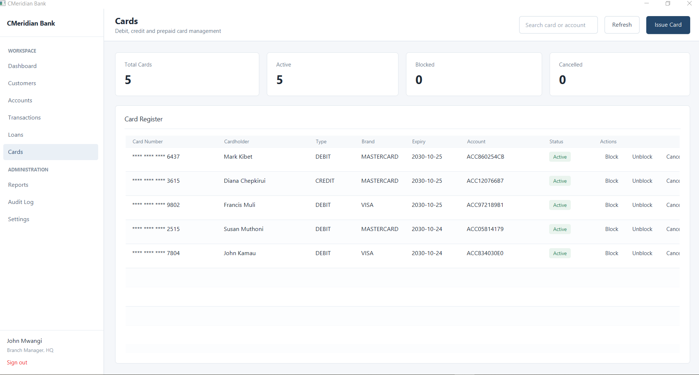
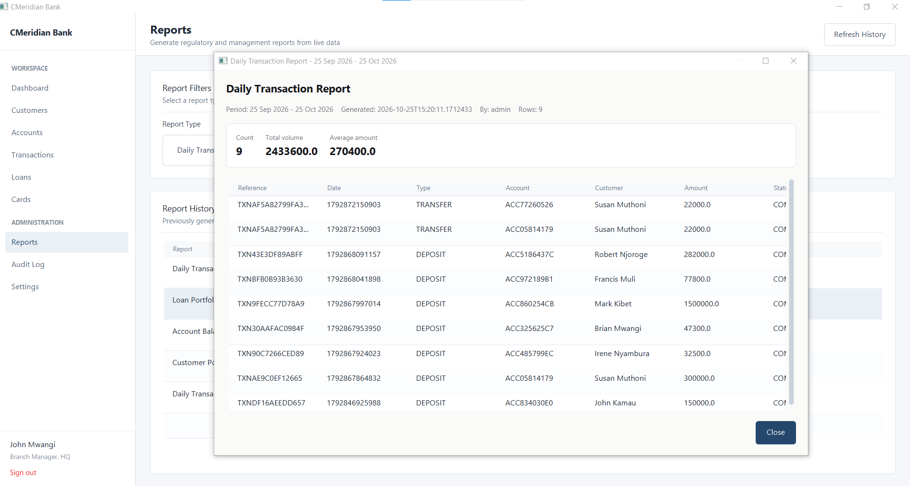
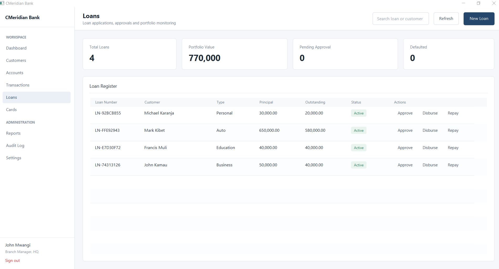
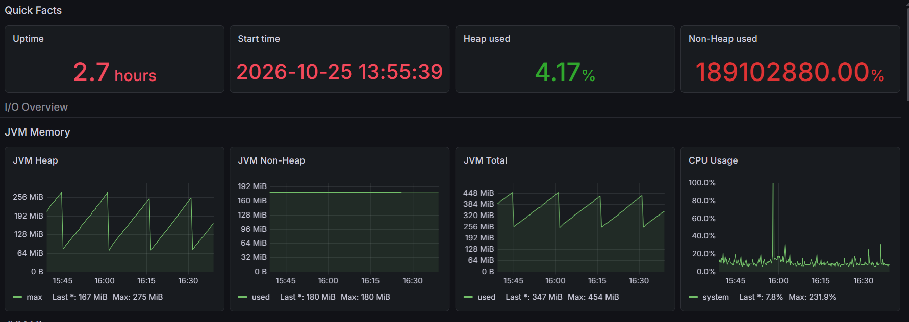

# CMeridian Core

**Enterprise Banking Operations Platform**

CMeridian Core is a banking operations system built with Spring Boot, JavaFX and PostgreSQL. It provides secure transaction processing, customer and account management, loan workflows, role-based access control, audit logging and infrastructure monitoring.

---

## Tech Stack

| Layer | Technology |
|---|---|
| Backend | Java 21, Spring Boot 3, Spring Security |
| Desktop Client | JavaFX 21, FXML |
| Database | PostgreSQL 15, Spring Data JPA, Flyway |
| Security | JWT, BCrypt, RBAC |
| Cache & Messaging | Redis, RabbitMQ |
| Monitoring | Prometheus, Grafana |
| Infrastructure | Docker, Docker Compose, Nginx |
| CI/CD | Jenkins |

---

## Features

- **Customer Management:** Onboarding, KYC verification, search and profile updates.
- **Account Management:** Savings, current, fixed deposit, joint accounts and account status management.
- **Transactions:** Deposits, withdrawals, transfers and reversals with transactional integrity.
- **Daily Limits:** Per-account transaction limits enforced within database transactions.
- **Loan Management:** Applications, approvals, disbursements and repayments.
- **Card Management:** Issuance, blocking, cancellation and spending limits.
- **Security:** JWT authentication, refresh tokens, permissions and account lockout.
- **Audit Logging:** Tracks user actions, authentication attempts and changes to sensitive data.
- **Observability:** JVM metrics, HTTP performance and database connection pool monitoring.

---

## Screenshots

### Desktop Client - Dashboard



### Account Management



### Cards Management



### Reports Management



### Loan Management



### Monitoring - Grafana JVM Dashboard



---

## Architecture

```
              JavaFX Desktop Client
                       │
                     Nginx
                       │
                Spring Boot API
                       │
          ┌────────────┼────────────┐
          │            │            │
      PostgreSQL     Redis       RabbitMQ
                       │
                  Prometheus
                       │
                    Grafana
```

The desktop client communicates with the backend through REST APIs.

---

## Project Structure

```
banking-system/
├── backend/             Spring Boot REST API
├── desktop-javafx/      JavaFX desktop client
├── database/            SQL scripts and migrations
└── infrastructure/      Docker Compose and service configs
```

---

## Prerequisites

- JDK 21
- Maven 3.9+
- Docker Desktop
- IntelliJ IDEA, Apache NetBeans or VS Code

---

## Getting Started

### 1. Start Infrastructure

```bash
cd infrastructure
docker compose up -d
docker compose ps
```

Wait for the required containers to become healthy.

### 2. Start the Backend

```bash
cd ../backend
mvn clean install -DskipTests
mvn spring-boot:run
```

Flyway applies database migrations automatically at startup.

PostgreSQL must be accessible at `localhost:5433`

### 3. Start the Desktop Client

In a separate terminal:

```bash
cd desktop-javafx
mvn javafx:run
```

Development login:

- **Username:** `admin`
- **Password:** `Admin@123`

### 4. Verify the Services

```bash
curl http://localhost:8080/actuator/health
```

Expected response:

```json
{
  "status": "UP"
}
```

Check Prometheus targets at http://localhost:9090/targets

---

## Service URLs

| Service | URL |
|---|---|
| Backend API | http://localhost:8080/api |
| Swagger UI | http://localhost:8080/api/swagger-ui.html |
| Actuator | http://localhost:8080/actuator |
| Prometheus | http://localhost:9090 |
| Grafana | http://localhost:3001 |
| pgAdmin | http://localhost:8082 |
| RabbitMQ | http://localhost:15672 |
| Jenkins | http://localhost:8082 |

Local development credentials for infrastructure services are configured in the environment and Docker Compose files.

---

## Database Design

The database contains 24 tables covering customers, accounts, transactions, loans, cards, permissions and audit records.

Key design principles:

- **Transaction Integrity:** Balance updates, ledger entries and daily limit checks execute within database transactions.
- **Optimistic Locking:** Version columns prevent silent overwrites during concurrent updates.
- **Auditability:** Transaction records capture balance-before and balance-after values.
- **Migration Management:** Flyway manages versioned, immutable schema migrations.
- **Access Control:** Permissions are enforced through Spring Security and `@PreAuthorize`.

---

## Flyway Guidelines

- Never modify a migration that has already been applied.
- Add a new numbered migration for every schema change.
- Use the Spring Boot runtime to apply migrations.
- Never drop the database to resolve a migration issue.

---

## Security

- BCrypt password hashing
- HMAC-SHA512 signed JWTs
- One-hour access tokens and seven-day refresh tokens
- Account lockout after five failed login attempts for 15 minutes
- Role-based permissions

---

## Backup and Restore

Create a database backup:

```bash
mkdir -p backups

docker exec banking_postgres \
  pg_dump -U bank_user -d banking_system \
  > backups/banking_$(date +%Y%m%d_%H%M%S).sql
```

Restore from a backup:

```bash
docker exec -i banking_postgres \
  psql -U bank_user -d banking_system \
  < backups/banking_20260101_120000.sql
```

---

## Project Status

- **Backend:** Core banking operations and REST API
- **Desktop:** JavaFX employee operations client
- **Infrastructure:** Containerized services and monitoring stack